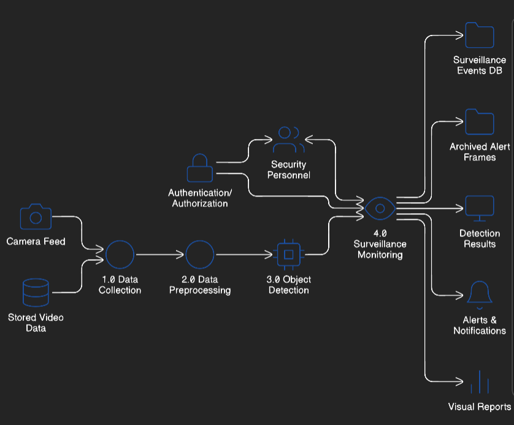

# SOFTWARE REQUIREMENTS SPECIFICATION (SRS)

## AI-Based Object Detection & CCTV Surveillance System

**Project Title:** Intelligent Visual Security and Alert Management System

**Subject Name:** Software Engineering and Project Management  
**Subject Code:** 21CSC303J  
**Academic Year:** 3  
**Semester:** VI  
**Section:** AK-1  

### Team Members
| Register Number | Name |
| :--- | :--- |
| RA2311026010583 | B S vikashsrikanth |
| RA2311026010585 | A Griffin george |
| RA2311026010587 | S kiran kumar |

---

## Architecture Diagram

### AI-Based Object Detection & CCTV Surveillance System

| Layer | Components |
| :--- | :--- |
| **Presentation Layer** | Admin Dashboard &nbsp;&nbsp;&nbsp;&nbsp;&nbsp;&nbsp; Monitoring Interface |
| **Application Layer** | Authentication Module &rarr; Monitoring Controller &rarr; Detection Engine &rarr; Alert System |
| **Business Logic Layer** | Frame Analysis Module &nbsp;&nbsp;&nbsp; Motion Detection &nbsp;&nbsp;&nbsp; AI Object Classification &nbsp;&nbsp;&nbsp; Event Trigger Logic |
| **Data Layer** | User Database &nbsp;&nbsp;&nbsp;&nbsp;&nbsp;&nbsp;&nbsp;&nbsp;&nbsp;&nbsp;&nbsp;&nbsp;&nbsp;&nbsp; Logs Database &nbsp;&nbsp;&nbsp;&nbsp;&nbsp;&nbsp;&nbsp;&nbsp;&nbsp;&nbsp;&nbsp;&nbsp;&nbsp;&nbsp; Reports/Evidence DB |
| **Infrastructure Layer** | Web Server / Local API &nbsp;&nbsp;&nbsp;&nbsp;&nbsp;&nbsp; Cloud/Local Storage &nbsp;&nbsp;&nbsp;&nbsp;&nbsp;&nbsp; Backup System |

---

### 1. Introduction
The system is designed to provide an automated, AI-driven security monitoring environment. By leveraging the **MobileNetSSD** architecture, it identifies and classifies objects in real-time, triggering alarms and logging evidence automatically.

### 2. Functional Requirements
*   **Module 1: Authentication**: Secure login for Admin and Security Personnel.
*   **Module 2: Monitoring Controller**: Orchestrates the video feed and detection engine.
*   **Module 3: Detection Engine**: Per-frame analysis for 21 object classes.
*   **Module 4: Alert System**: Real-time sound (Beep) and visual alerts.

### 3. Non-Functional Requirements
*   **Performance**: Minimum 10 FPS detection speed.
*   **Availability**: 24/7 continuous monitoring capability.
*   **Security**: Encrypted logs and role-based access control.
